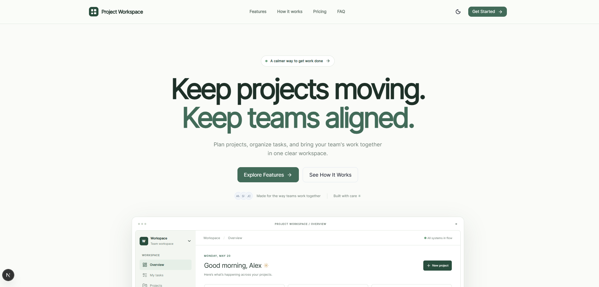

# SaaS Landing



A project-management landing page template for [Pimolu UI](https://pimolu.com). Project Workspace is a fictional product: its workspace, plans, and activity are local demonstration content. There is no account, backend, checkout, or subscription service.

## Stack

- Next.js App Router, React, and strict TypeScript
- Tailwind CSS 4 and semantic CSS using Pimolu theme concepts
- Published `@pimolu/react` and `@pimolu/web-styles` packages (currently 0.1.0-beta.2)
- Lucide React icons
- npm

The Pimolu packages are a public beta. Their published React peer range supports React 18 and 19. The project consumes the npm packages directly; it does not require a clone or build of the Pimolu monorepo. See the [official repository](https://github.com/pimoludev/ui), [documentation](https://www.pimolu.com/docs), and [components](https://www.pimolu.com/components).

## Getting started

Use Node.js 20.9 or later (Node 22 LTS recommended) and npm:

```sh
npm ci
npm run dev
```

Open [http://localhost:3000](http://localhost:3000). Other checks:

```sh
npm run typecheck
npm run lint
npm run build
npm run start
```

## Make it yours

Edit `lib/content.ts` for the product name, description, navigation, repository link, example plans, and FAQ. Demo project and team data and the remaining section copy live in `components/landing.tsx`. Styles and responsive breakpoints are in `app/globals.css`; metadata is in `app/layout.tsx`. Replace the original icon in `app/icon.svg`. The copy is in English and deliberately has no i18n runtime: move the content into locale dictionaries when adding translations.

The plan amounts in `lib/content.ts` are per user per month. Yearly amounts are monthly equivalents; the annual total is calculated as twelve times that amount. Pricing and calls to action are illustrative and never initiate payment.

## Themes and Pimolu UI

`components/theme-provider.tsx` wraps the page in `PimoluProvider` with a controlled `light` or `dark` theme and a brand color. The theme toggle saves a same-site cookie; `app/layout.tsx` reads it on the server to render the selected theme on the first response. The default is light. The layout uses CSS variables in `app/globals.css` for page-specific surfaces and text; Pimolu components receive the official provider theme and stylesheet. Change the brand color in the provider and the page variables together when rebranding.

The template imports the published Pimolu `Button`, `Card`, `Badge`, `Avatar`, `AvatarGroup`, `Progress`, `Tabs` and `Accordion` families. Links use Pimolu's documented button CSS classes because a link must remain an anchor and the package's `buttonVariants` helper is not exported from its public entry point. Page layout, illustrative dashboard rows, and visual charts use semantic HTML and CSS. They are demo compositions rather than missing library components; Pimolu also publishes more specialized dashboard and data components that can be substituted for a real application.

## Project structure

```text
app/                  App Router, metadata, global styles and icon
components/           Landing page and theme provider
lib/content.ts        Shared copy, navigation, FAQ and example pricing
public/               Static assets
```

## Use as a GitHub template

The repository owner must enable **Template repository** in the GitHub repository settings. Once enabled, choose **Use this template** on GitHub to create your own independent repository. This setting is managed on GitHub and is not enabled by the source code.

## Deploy to Vercel

Import your repository into Vercel and deploy with the Next.js defaults. The lockfile supplies npm dependencies; no environment variables or local resources are required. Set your own production domain and update metadata and links before publishing. The server-rendered theme cookie requires a Node-compatible Next.js deployment; the site is not a static export.

## Scope and accessibility

The mobile menu, theme switch, product tabs, pricing toggle, FAQ, and internal navigation are interactive. Product dashboard actions and data are illustrative; there are no real project operations. Animations honor `prefers-reduced-motion`. Test your own content, contrast, keyboard navigation, and integrations before launching a real product.

## License

MIT. See [LICENSE](LICENSE).


